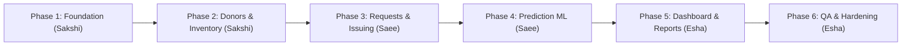

# BloodLink — Living Implementation & Agent Handoff Plan

> **Single Source of Truth Reference:** [PROJECT.md](file:///c:/Users/Sakshi/BloodLink/PROJECT.md)  
> **Architecture & Domain:** Healthcare Informatics · Blood Bank Management & Availability Prediction  
> **Tech Stack:** FastAPI (Python 3.11+), PostgreSQL 16 (Docker Compose), React (Vite, JavaScript, Tailwind CSS), SQLAlchemy 2.x, Alembic, scikit-learn / statsmodels / ReportLab.

---

## 1. Project Status Dashboard

| Metric | Current State |
|---|---|
| **Current Phase** | **Phase 2 — Donors, Inventory & Compatibility** |
| **Overall Project Status** | **IN_PROGRESS (Phase 1 Complete)** |
| **Completed Phases** | **Phase 1** (1 / 6) |
| **Current Blockers** | None |
| **Last Updated** | 2026-10-21 |
| **Next Developer's Task** | **Sakshi** to build Phase 2: donor lifecycle & eligibility rules (`services/eligibility.py`), blood unit collection with 42-day expiry (`services/donors.py`), automated & scheduled expiry sweep (`services/inventory.py`, `jobs/scheduler.py`), compatibility engine (`services/compatibility.py`), ranked stock matching lookups (`services/matching.py`), and frontend donor/inventory screens (Tasks 2.1–2.12). |

---

## 2. Team & Phase Allocation

Work is divided **strictly by phase**, not by layer. Each developer/agent owns both backend, database, analytics, frontend, and tests for their assigned vertical phases.

| Phase | Phase Name | Assigned Developer | Modules Covered | Status |
|:---:|---|:---:|---|:---:|
| **1** | Foundation & Setup | **Sakshi** | Module 1 (Auth, RBAC, Users, Staff, Activity Logs) | `COMPLETE` |
| **2** | Donors, Inventory & Compatibility | **Sakshi** | Module 2 (Donors), Module 3 (Inventory), Module 5 (Compatibility Rules & Stock Lookups) | `READY_TO_START` |
| **3** | Requests & Issuing | **Saee** | Module 4 (Requests & Issuing), Module 5 (Request-level Matches) | `NOT_STARTED` |
| **4** | Shortage Prediction | **Saee** | Module 6 (Shortage Prediction Analytics, Synthetic Seeder) | `NOT_STARTED` |
| **5** | Dashboard, Reports, Camps & Admin Screens | **Esha** | Module 7 (Dashboard & Reports), Donation Camps, Admin Views | `NOT_STARTED` |
| **6** | Hardening, QA, Documentation & Demo | **Esha** | System-wide QA, RBAC Audit, Concurrency & Security, Demo Script | `NOT_STARTED` |

---

## 3. Agent Handoff Protocol

Every AI agent and developer working on any phase MUST strictly adhere to this protocol:

### At the Start of Every Phase:
1. **Read [PROJECT.md](file:///c:/Users/Sakshi/BloodLink/PROJECT.md)** completely to understand business rules, schema contracts, and API specifications.
2. **Read [IMPLEMENTATION_PLAN.md](file:///c:/Users/Sakshi/BloodLink/IMPLEMENTATION_PLAN.md)** to inspect the current state, recent changes, decisions, and instructions left by the previous developer.
3. **Inspect the repository state and git history** of the previous phase to verify code structure and conventions.
4. **Run existing test suites** (`pytest` in `backend/`, and frontend checks) to ensure the baseline is 100% green before writing any new code.
5. **Implement ONLY the assigned phase**. Do not leap ahead into future phase scopes or alter established contracts without cross-team consensus.

### At the End of Every Phase:
1. **Run full automated test suites**: unit, API, integration, and security checks.
2. **Fix any failures or regressions** immediately.
3. **Update [IMPLEMENTATION_PLAN.md](file:///c:/Users/Sakshi/BloodLink/IMPLEMENTATION_PLAN.md)**:
   - Mark the completed phase as `COMPLETE`.
   - Update `Current Phase`, `Overall Project Status`, `Completed Phases`, and `Last Updated`.
   - Record exact files created/modified, tests passed, architectural decisions, edge cases handled, and known notes.
   - Provide explicit, step-by-step instructions for the incoming developer.
4. **Commit and merge the completed phase** cleanly with descriptive, imperative commit messages.

---

## 4. Phase-by-Phase Implementation Specifications



---

### Phase 1 — Foundation & Setup
- **Phase Objective:** Establish a fully functional, containerized, test-backed full-stack skeleton: Docker PostgreSQL, FastAPI backend with SQLAlchemy 2.x and Alembic (all 10 tables + `v_transactions` view), JWT auth with RBAC, activity logging, admin bootstrapping, pytest setup, and a Vite + React + Tailwind frontend shell with shared UI components and auth pages.
- **Assigned Developer / Phase Owner:** **Sakshi**
- **Status:** `COMPLETE`
- **Dependencies:** None (initial foundation phase).
- **Files to Create / Modify:**
  ```text
  .gitignore
  README.md
  docker-compose.yml
  docker/initdb/01-create-test-db.sql
  backend/.env.example
  backend/.env
  backend/requirements.txt
  backend/requirements-dev.txt
  backend/alembic.ini
  backend/alembic/env.py
  backend/alembic/versions/001_initial_schema.py
  backend/app/main.py
  backend/app/core/config.py
  backend/app/core/clock.py
  backend/app/core/security.py
  backend/app/core/deps.py
  backend/app/core/errors.py
  backend/app/core/constants.py
  backend/app/db/base.py
  backend/app/db/session.py
  backend/app/models/__init__.py
  backend/app/models/user.py
  backend/app/models/staff.py
  backend/app/models/requester.py
  backend/app/models/donor.py
  backend/app/models/blood_unit.py
  backend/app/models/blood_request.py
  backend/app/models/issue_record.py
  backend/app/models/donation_camp.py
  backend/app/models/activity_log.py
  backend/app/models/shortage_prediction.py
  backend/app/schemas/auth.py
  backend/app/schemas/staff.py
  backend/app/schemas/activity_log.py
  backend/app/api/router.py
  backend/app/api/health.py
  backend/app/api/auth.py
  backend/app/api/staff.py
  backend/app/api/activity_logs.py
  backend/app/services/activity_log.py
  backend/scripts/create_admin.py
  backend/tests/conftest.py
  backend/tests/api/test_health.py
  backend/tests/api/test_auth.py
  backend/tests/api/test_staff.py
  backend/tests/api/test_activity_logs.py
  backend/tests/unit/test_schema.py
  frontend/package.json
  frontend/vite.config.js
  frontend/index.html
  frontend/.env.example
  frontend/src/index.css
  frontend/src/main.jsx
  frontend/src/App.jsx
  frontend/src/api/client.js
  frontend/src/api/auth.js
  frontend/src/context/AuthContext.jsx
  frontend/src/context/ToastContext.jsx
  frontend/src/utils/constants.js
  frontend/src/utils/errors.js
  frontend/src/utils/format.js
  frontend/src/hooks/useFetch.js
  frontend/src/hooks/usePagination.js
  frontend/src/components/ui/Button.jsx
  frontend/src/components/ui/Input.jsx
  frontend/src/components/ui/Select.jsx
  frontend/src/components/ui/Modal.jsx
  frontend/src/components/ui/ConfirmDialog.jsx
  frontend/src/components/ui/Badge.jsx
  frontend/src/components/ui/Table.jsx
  frontend/src/components/ui/Pagination.jsx
  frontend/src/components/ui/StatCard.jsx
  frontend/src/components/ui/Spinner.jsx
  frontend/src/components/ui/EmptyState.jsx
  frontend/src/components/ui/ErrorBanner.jsx
  frontend/src/layouts/AuthLayout.jsx
  frontend/src/layouts/StaffLayout.jsx
  frontend/src/layouts/RequesterLayout.jsx
  frontend/src/routes/AppRoutes.jsx
  frontend/src/routes/ProtectedRoute.jsx
  frontend/src/pages/auth/LoginPage.jsx
  frontend/src/pages/auth/RegisterPage.jsx
  frontend/src/pages/NotFoundPage.jsx
  ```
- **Main Implementation Tasks:**
  - **Task 1.1 (Repository & Infrastructure):** Initialize Git repository structure; `.gitignore` (Python, Node, `.env`, `backend/ml/artifacts/`); `docker-compose.yml` (PostgreSQL 16 on 5432 with `bloodlink` user/password/db, volume, and `docker/initdb/01-create-test-db.sql` creating `bloodlink_test`); root `README.md` skeleton.
  - **Task 1.2 (Backend Scaffold):** `main.py` with FastAPI factory, CORS middleware (`CORS_ORIGINS`), global exception handlers (`core/errors.py`), centralized clock helper (`core/clock.py → today()`), `core/config.py` using `pydantic-settings`, unpinned dependencies in `requirements.txt` & `requirements-dev.txt` (including ML and ReportLab libraries).
  - **Task 1.3 (Database Models):** SQLAlchemy 2.x declarative models matching Section 7.2 schema: `users`, `staff`, `requesters`, `donors`, `blood_units`, `blood_requests`, `issue_records`, `donation_camps`, `activity_logs`, `shortage_predictions`. All foreign keys `ON DELETE RESTRICT`.
  - **Task 1.4 (Alembic Migration):** Alembic setup (`env.py` reading `DATABASE_URL`), initial migration creating all 10 tables, check constraints, foreign keys, indexes (Section 7.3), and SQL view `v_transactions` (Section 7.4). Verified `upgrade head` and `downgrade base`.
  - **Task 1.5 (Security & Auth Core):** Direct `bcrypt` password hashing and verification; `PyJWT` token generation (HS256, 60m expiration) and decoding; FastAPI dependency `core/deps.py` (`get_db`, `get_current_user`, `require_roles(*roles)`). Enforce that `is_active=False` accounts are blocked with 403 `ACCOUNT_DISABLED`.
  - **Task 1.6 (Auth & Staff Endpoints):**
    - `GET /api/health` (Public, queries DB).
    - `POST /api/auth/login` (Public, username/password → JWT token + user object).
    - `POST /api/auth/register` (Public, requester registration creating both `users` with role `requester` and `requesters` row; returns JWT + user).
    - `GET /api/auth/me` (Authenticated A/S/R, returns current user + `profile_id`).
    - Staff CRUD under `/api/staff` (Admin only). Prevent self-modification / self-deletion (`SELF_MODIFICATION_FORBIDDEN`).
  - **Task 1.7 (Activity Logging):** Service `services/activity_log.py` with `record(db, user_id, action, entity_type, entity_id, details)`. Wire into auth registration and staff writes. `GET /api/activity-logs` endpoint (Admin only, paginated, filtered).
  - **Task 1.8 (Admin Bootstrap Script):** CLI script `scripts/create_admin.py --username admin --password <pass> --name Admin` creating an active `admin` user and `staff` row.
  - **Task 1.9 (Backend Tests):** Pytest suite with `conftest.py` targeting `bloodlink_test`. Automated Alembic migrations in tests, rollback/clean per test, role-authenticated test clients (`admin_client`, `staff_client`, `requester_client`), frozen clock fixture. Tests for auth, RBAC, staff CRUD, activity logging, and schema constraints.
  - **Task 1.10–1.14 (Frontend Scaffold & Core):** Vite + React (plain JavaScript, no TypeScript) + Tailwind CSS. Setup `api/client.js` with Axios interceptors attaching Bearer token and redirecting to `/login` on 401; `AuthContext` (token stored in localStorage); `ToastContext`; route protection (`ProtectedRoute` with `allowedRoles`); `StaffLayout` (sidebar navigation) and `RequesterLayout` (top navigation); shared UI kit; `LoginPage` and `RegisterPage` hooked to backend; placeholder pages for future routes.
- **APIs / Modules / Contracts Involved:**
  - `GET /api/health` -> `{status: "ok", database: "ok"}`
  - `POST /api/auth/login` -> `{access_token, token_type: "bearer", user: {user_id, username, role, name, profile_id}}`
  - `POST /api/auth/register` -> Body: `{username, password, name, type, phone, address}` -> 201 Created + Token & User
  - `GET /api/auth/me` -> `{user_id, username, role, name, profile_id}`
  - `GET /api/staff`, `POST /api/staff`, `GET /api/staff/{id}`, `PATCH /api/staff/{id}`, `DELETE /api/staff/{id}`
  - `GET /api/activity-logs` -> `{items: [...], total, page, page_size}`
  - Error Envelope: `{"detail": {"code": "...", "message": "...", ...}}`
- **Security Requirements:**
  - Password minimum 8 characters; hashed with `bcrypt`; never returned in any response.
  - JWT tokens signed with HS256, expired after 60 minutes (`ACCESS_TOKEN_EXPIRE_MINUTES`).
  - Strict RBAC: `/api/staff` and `/api/activity-logs` are strictly Admin-only.
  - Admin cannot deactivate, demote, or delete their own account (`SELF_MODIFICATION_FORBIDDEN`).
  - Account status check: `is_active = false` returns HTTP 403 `ACCOUNT_DISABLED`.
  - CORS strictly configured to frontend origin.
- **Tests Required:**
  - Unit: password hashing, JWT encoding/decoding, configuration loading.
  - Integration/API: Health check, login success/failure, register requester, me endpoint for all 3 roles, staff CRUD, self-modification guard, activity log recording on writes, admin-only route guards.
  - Migration: test DB upgrade head and downgrade base.
- **Acceptance Criteria:**
  - `docker compose up -d` brings up Postgres with `bloodlink` and `bloodlink_test`.
  - `alembic upgrade head` succeeds cleanly on empty database; all 10 tables, indexes, and `v_transactions` created.
  - `python -m scripts.create_admin` creates functional admin.
  - Pytest passes 100%.
  - Frontend starts (`npm run dev`), user can register as requester, admin/staff can log in, routing and layout separation works.
- **Handoff Notes for Phase 2 (Sakshi):**
  - All DB models, migrations, auth dependencies (`deps.py`), and UI kit are established. Phase 2 extends `services/`, creates donor and inventory endpoints, and builds donor and inventory UI screens using the shared UI components.

---

### Phase 2 — Donors, Inventory & Compatibility

- **Phase Objective:** Implement donor lifecycle and eligibility rules, blood unit collection via donation (atomic inventory creation with 42-day shelf life), automated and scheduled expiry sweep, blood group compatibility rules, and ranked nearest-expiry-first stock lookups.
- **Assigned Developer / Phase Owner:** **Sakshi**
- **Status:** `NOT_STARTED`
- **Dependencies:** Phase 1 complete (schema, auth, base models, UI kit, API client).
- **Files to Create / Modify:**
  ```text
  backend/app/services/eligibility.py
  backend/app/services/compatibility.py
  backend/app/services/matching.py
  backend/app/services/inventory.py
  backend/app/services/donors.py
  backend/app/jobs/scheduler.py
  backend/app/schemas/donor.py
  backend/app/schemas/inventory.py
  backend/app/schemas/matching.py
  backend/app/api/donors.py
  backend/app/api/inventory.py
  backend/app/api/matching.py
  backend/app/main.py (register routers + lifespan scheduler/expiry)
  backend/tests/unit/test_eligibility.py
  backend/tests/unit/test_compatibility.py
  backend/tests/unit/test_matching.py
  backend/tests/api/test_donors.py
  backend/tests/api/test_inventory.py
  backend/tests/api/test_matching.py
  frontend/src/api/donors.js
  frontend/src/api/inventory.js
  frontend/src/api/matching.js
  frontend/src/pages/donors/DonorListPage.jsx
  frontend/src/pages/donors/DonorFormPage.jsx
  frontend/src/pages/donors/DonorDetailPage.jsx
  frontend/src/pages/inventory/InventoryPage.jsx
  ```
- **Main Implementation Tasks:**
  - **Task 2.1 (Eligibility Service):** Implement pure function in `app/services/eligibility.py` evaluating age (18–65 inclusive), weight (≥ 50 kg), and donation gap (≥ 90 days or never donated). Failure codes: `AGE_BELOW_MIN`, `AGE_ABOVE_MAX`, `WEIGHT_BELOW_MIN`, `DONATION_GAP_NOT_MET`. Date evaluated against `clock.today()`.
  - **Task 2.2 (Compatibility & Matching Services):**
    - `app/services/compatibility.py`: Define canonical `COMPATIBILITY` dictionary (whole blood / red cell compatibility matrix for all 8 groups).
    - `app/services/matching.py`: Query available, non-expired units belonging to compatible blood groups, ordered strictly by `expiry_date ASC, unit_id ASC`.
  - **Task 2.3 (Donor Endpoints):**
    - `POST /api/donors` (A, S): Create donor profile.
    - `GET /api/donors` (A, S): Paginated with filters (`blood_group`, `location`, `last_donation_before`, `last_donation_after`, `is_regular`, `q`, `sort`).
    - `GET /api/donors/{id}` (A, S): Details + `donation_count`, `is_regular` (≥ 3 donations), `eligibility` status.
    - `PATCH /api/donors/{id}` (A, S): Partial update. Block changing `blood_group` if donor has existing units (`409 DONOR_HAS_UNITS`).
    - `DELETE /api/donors/{id}` (A only): Delete donor. Block if referenced by units (`409 REFERENCED_RECORD`).
    - `GET /api/donors/{id}/eligibility` (A, S): Detailed eligibility check result.
  - **Task 2.4 (Donation Endpoints & Transaction):**
    - `POST /api/donors/{id}/donations` (A, S): Atomic transaction: evaluate eligibility (reject with 409 `ELIGIBILITY_FAILED` if ineligible); insert `blood_units` row (`collection_date = today()`, `expiry_date = today() + 42 days`, `status = 'available'`); update `donor.last_donation_date = today()`; write activity log (`create`, `blood_unit`).
    - `GET /api/donors/{id}/donations` (A, S): List donor's donation history (units, newest first).
  - **Task 2.5 (Inventory Service & Endpoints):**
    - Implement `expire_overdue_units()`: update `blood_units` setting `status = 'expired'` where `status = 'available' AND expiry_date < today()`.
    - `GET /api/inventory/stock` (A, S): Stock count per blood group (all 8 groups zero-filled) + `total_available_units`.
    - `GET /api/inventory/units` (A, S): Paginated units with filters (`blood_group`, `status`, `donor_id`, `expiring_within_days`).
    - `GET /api/inventory/units/{id}` (A, S): Unit detail.
    - `GET /api/inventory/expiring` (A, S): Available units expiring within `EXPIRY_ALERT_DAYS` (default 7), soonest first.
    - `POST /api/inventory/expire-overdue` (A, S): Trigger manual expiry sweep.
    - `DELETE /api/inventory/units/{id}` (A only): Delete unit. Block if `status == 'issued'` (`409 UNIT_ALREADY_ISSUED`) or referenced (`409 REFERENCED_RECORD`).
  - **Task 2.6 (Scheduler & Startup Expiry):** Setup APScheduler `BackgroundScheduler` in `jobs/scheduler.py` running daily expiry sweep; run sweep at FastAPI startup in `main.py` lifespan.
  - **Task 2.7 (Standalone Matching Lookups):**
    - `GET /api/matching/compatibility`: Return full compatibility matrix dictionary.
    - `GET /api/matching/units`: Query param `blood_group` (required), `limit` (optional); returns compatible available units ranked by expiry.
  - **Task 2.8 (Activity Logging & Automated Tests):** Activity logging on all donor and inventory mutations. Extensive unit tests for eligibility boundary conditions (17/18/65/66 years, 49.9/50 kg, 89/90 days gap), donation atomicity, expiry sweep, delete restrictions, and matching sort orders.
  - **Task 2.9–2.12 (Frontend UI Screens):**
    - `DonorListPage`: Paginated table, search/filter controls, "Regular" badge, navigation to form/detail.
    - `DonorFormPage`: Create and edit donor with client validation.
    - `DonorDetailPage`: Demographics, eligibility alert card, "Record Donation" button (disabled with explanation if ineligible), donation history table, admin delete dialog.
    - `InventoryPage`: Stock summary cards (red highlight for stock < safe minimum 10), tabs for "All Units" and "Expiring Soon", "Run Expiry Sweep" action, unit deletion (admin).
- **APIs / Modules / Contracts Involved:**
  - `POST /api/donors` -> 201 Created
  - `GET /api/donors` -> `{items: [...], total, page, page_size}`
  - `GET /api/donors/{id}` -> Donor object + `donation_count`, `is_regular`, `eligibility`
  - `POST /api/donors/{id}/donations` -> 201 Created `BloodUnit` object
  - `GET /api/inventory/stock` -> `{as_of, stock: [{blood_group, available_units}], total_available_units}`
  - `GET /api/matching/units?blood_group=A+` -> `[{unit_id, blood_group, expiry_date, days_to_expiry}]`
- **Security Requirements:**
  - Staff & Admin only for all donor and inventory operations (Requesters receive 403 `FORBIDDEN`).
  - Admin-only deletion of donors and inventory units.
  - Foreign key safety: Cannot delete donor with existing units (`REFERENCED_RECORD`).
  - Unit safety: Cannot delete issued blood units (`UNIT_ALREADY_ISSUED`).
- **Tests Required:**
  - Unit tests for `eligibility.py` (exact edge cases: 17, 18, 65, 66 years old; 49.9kg vs 50kg; 89 vs 90 days gap; multiple reasons).
  - Unit tests for `compatibility.py` (all 8 recipient groups map to correct donors).
  - API tests: Donor CRUD, donor filters, donation recording (success creates unit with 42-day expiry, failure leaves DB untouched), inventory stock aggregation, expiry sweep marking expired units, delete protections.
- **Handoff Notes for Phase 3 (Sakshi -> Saee):**
  - **What Saee receives:** Fully populated donor & inventory backend and frontend; working `services/compatibility.py` with `COMPATIBILITY` dict; working `services/matching.py` with ranked compatible query; working `expire_overdue_units()`.
  - **What Saee needs to build in Phase 3:** Use `services/matching.py` and `expire_overdue_units()` to implement the request approve/reject/issue workflow with row locks (`SELECT ... FOR UPDATE`), build requester portal screens, and staff request queue screens.

---

### Phase 3 — Requests & Issuing

- **Phase Objective:** Deliver the end-to-end blood request and issuing workflow. Requesters can self-register, submit blood requests, and track status. Staff can view priority-sorted requests, inspect compatible units (nearest-expiry-first), approve/reject requests, and atomically issue blood units with row locking and audit traceability.
- **Assigned Developer / Phase Owner:** **Saee**
- **Status:** `NOT_STARTED`
- **Dependencies:** Phase 1 (Auth, DB) and Phase 2 (Donors, Inventory, Compatibility engine, `matching.py`, `expire_overdue_units`).
- **Files to Create / Modify:**
  ```text
  backend/app/services/issuing.py
  backend/app/schemas/requester.py
  backend/app/schemas/request.py
  backend/app/api/requesters.py
  backend/app/api/requests.py
  backend/app/main.py (mount requesters and requests routers)
  backend/tests/api/test_requesters.py
  backend/tests/api/test_requests.py
  backend/tests/unit/test_issuing.py
  frontend/src/api/requesters.js
  frontend/src/api/requests.js
  frontend/src/pages/requester/MyRequestsPage.jsx
  frontend/src/pages/requester/NewRequestPage.jsx
  frontend/src/pages/requester/MyRequestDetailPage.jsx
  frontend/src/pages/requester/MyProfilePage.jsx
  frontend/src/pages/requests/RequestQueuePage.jsx
  frontend/src/pages/requests/RequestDetailPage.jsx
  frontend/src/pages/requesters/RequestersPage.jsx
  ```
- **Main Implementation Tasks:**
  - **Task 3.1 (Requester Endpoints):**
    - Declare `/me` routes before parameterized `/{requester_id}` routes.
    - `GET /api/requesters/me` (R): Get own requester profile.
    - `PATCH /api/requesters/me` (R): Update own profile fields (`name`, `type`, `phone`, `address`).
    - `GET /api/requesters` (A, S): Paginated requester list with `type` and `q` search.
    - `GET /api/requesters/{id}` (A, S): Requester detail.
    - `DELETE /api/requesters/{id}` (A only): Delete requester profile and underlying user (protected by `ON DELETE RESTRICT` if requests exist).
  - **Task 3.2 (Blood Request Endpoints):**
    - `POST /api/requests` (R only): Create request (`blood_group`, `quantity`, `urgency` ∈ {emergency, routine}). Sets `status = 'pending'`, `request_date = today()`.
    - `GET /api/requests`:
      - If Requester (R): Filtered strictly to `requester_id == current_user.profile_id`.
      - If Staff/Admin (A, S): All requests. Supports filters (`status`, `urgency`, `blood_group`, `requester_id`).
      - Sorting: `sort=priority` (default for Staff: emergency first, then `request_date ASC`, `request_id ASC`) or `sort=newest` (default for Requester).
    - `GET /api/requests/{id}`: Request detail with `issued_units` list. Requesters can only access their own (others return 404).
    - `DELETE /api/requests/{id}` (A only): Delete request. Block if status is `issued` (`409 REFERENCED_RECORD`).
  - **Task 3.3 (Request Matches Endpoint):**
    - `GET /api/requests/{id}/matches` (A, S): Uses `services/matching.py` to fetch compatible available units. Returns:
      - `compatible_groups`: array of compatible blood groups.
      - `available_compatible_count`: total count of compatible units.
      - `sufficient`: boolean (`available_compatible_count >= request.quantity`).
      - `allocation_preview_unit_ids`: the first `quantity` unit IDs.
      - `units`: full list of candidates ranked soonest-expiry first.
  - **Task 3.4 (Workflow State Machine & Atomic Issuing):**
    - Implement `app/services/issuing.py`:
      - `POST /api/requests/{id}/approve` (A, S): Transition `pending -> approved`. Log activity.
      - `POST /api/requests/{id}/reject` (A, S): Transition `pending/approved -> rejected`. Log activity.
      - `POST /api/requests/{id}/issue` (A, S):
        1. Run `expire_overdue_units()`.
        2. Validate status == `approved` (else 409 `INVALID_STATUS_TRANSITION`).
        3. Lock candidates using `SELECT ... FOR UPDATE` on `blood_units`.
        4. Check if available compatible units count >= `quantity`. If not, abort with 409 `INSUFFICIENT_STOCK` (include `requested` and `available`).
        5. Insert `issue_records` (`request_id`, `unit_id`, `issue_date = today()`, `issued_by = current_user.staff_id`).
        6. Set unit `status = 'issued'`.
        7. Set request `status = 'issued'`.
        8. Write activity log (`issue`, `blood_request`, details contain allocated unit IDs).
        9. Commit transaction (all-or-nothing).
  - **Task 3.5 (Backend Tests):**
    - Test all legal and illegal state transitions (`pending -> approved -> issued`, `pending -> rejected`, `approved -> rejected`; forbid `rejected -> approved`, `issued -> rejected`).
    - Requester isolation: accessing another requester's request returns 404 `NOT_FOUND`.
    - Priority sorting vs. newest sorting.
    - Insufficient stock rolls back cleanly without state change.
    - **Concurrency test:** Simulate two concurrent issue requests competing for overlapping units; verify that no unit is double-issued and one request fails cleanly with `INSUFFICIENT_STOCK`.
    - Traceability verification: `issue_records` links unit, donor, request, and staff.
  - **Task 3.6–3.9 (Frontend UI Screens):**
    - Requester Portal: `MyRequestsPage` (status badges, submit button), `NewRequestPage` (form with validation), `MyRequestDetailPage` (details and issued units), `MyProfilePage`.
    - Staff Portal: `RequestQueuePage` (priority order, urgency badges, filter tabs), `RequestDetailPage` (request info, interactive Matches panel showing sufficiency, preview unit IDs, Approve / Reject / Issue action buttons with confirmations, error modal for `INSUFFICIENT_STOCK`), `RequestersPage` (staff view of registered hospitals/patients).
- **APIs / Modules / Contracts Involved:**
  - `POST /api/requests` -> 201 Created Request
  - `GET /api/requests` -> `{items: [...], total, page, page_size}`
  - `GET /api/requests/{id}/matches` -> `{request_id, requested_group, quantity, compatible_groups, available_compatible_count, sufficient, allocation_preview_unit_ids, units}`
  - `POST /api/requests/{id}/approve` -> 200 OK
  - `POST /api/requests/{id}/reject` -> 200 OK
  - `POST /api/requests/{id}/issue` -> 200 OK
  - Error: `409 INSUFFICIENT_STOCK` -> `{detail: {code: "INSUFFICIENT_STOCK", message: "...", requested: 3, available: 1}}`
  - Error: `409 INVALID_STATUS_TRANSITION` -> `{detail: {code: "INVALID_STATUS_TRANSITION", message: "..."}}`
- **Security Requirements:**
  - Requester isolation: Requesters can only view and create their own requests; querying another's request yields 404.
  - Concurrency safety: `SELECT ... FOR UPDATE` ensures no race conditions during blood allocation.
  - Role protection: Only Requesters can create requests; only Staff/Admin can approve, reject, or issue.
- **Tests Required:**
  - State machine transition tests (all valid and invalid transitions).
  - Concurrency test with multi-threaded/concurrent httpx clients issuing simultaneously.
  - Requester permission isolation tests.
  - Full request-to-issue lifecycle test.
- **Handoff Notes for Phase 4 (Saee):**
  - **What Saee receives:** Fully functional operational blood bank system (donors, inventory, requests, issuing). Every transaction is reflected in `blood_units`, `issue_records`, and the `v_transactions` view.
  - **What Saee needs to build in Phase 4:** Build the synthetic data seeder (`scripts/seed_synthetic_data.py`) to generate realistic 365-day operational history, then build the standalone `backend/ml/` prediction package (Linear Regression, Holt-Winters, ARIMA), hold-out evaluation, and prediction API endpoints.

---

### Phase 4 — Shortage Prediction

- **Phase Objective:** Implement the predictive analytics engine. Build the calibrated synthetic data generator to simulate realistic donation/request history, develop the `backend/ml/` package (data aggregation from `v_transactions`, candidate models, hold-out evaluation, automated model selection), expose prediction and alert endpoints via FastAPI, build the predictions frontend dashboard, and document evaluation in `docs/ml_evaluation.md`.
- **Assigned Developer / Phase Owner:** **Saee**
- **Status:** `NOT_STARTED`
- **Dependencies:** Phase 3 complete (`v_transactions` view populated with donations, issues, and wastage; operational business logic in place).
- **Files to Create / Modify:**
  ```text
  backend/scripts/seed_synthetic_data.py
  backend/ml/__init__.py
  backend/ml/config.py
  backend/ml/data.py
  backend/ml/models/__init__.py
  backend/ml/models/base.py
  backend/ml/models/linear_regression.py
  backend/ml/models/holt_winters.py
  backend/ml/models/arima.py
  backend/ml/evaluation.py
  backend/ml/pipeline.py
  backend/ml/persistence.py
  backend/ml/cli.py
  backend/ml/artifacts/.gitkeep
  backend/app/schemas/prediction.py
  backend/app/api/predictions.py
  backend/app/services/prediction_alerts.py
  backend/app/main.py (mount predictions router)
  backend/tests/ml/test_data.py
  backend/tests/ml/test_models.py
  backend/tests/ml/test_evaluation.py
  backend/tests/ml/test_pipeline.py
  backend/tests/api/test_predictions.py
  backend/tests/unit/test_seeder.py
  docs/ml_evaluation.md
  frontend/src/api/predictions.js
  frontend/src/components/charts/ForecastChart.jsx
  frontend/src/pages/predictions/PredictionsPage.jsx
  ```
- **Main Implementation Tasks:**
  - **Task 4.1 (Synthetic Data Generator):**
    - `backend/scripts/seed_synthetic_data.py`: CLI script with `--days 365 --seed 42 --reset`.
    - Resets DB, creates standard demo accounts: `admin / admin12345`, `staff / staff12345`, `hospital / hospital12345`.
    - Simulates operational workflow day by day: expires overdue units, generates daily donations honouring eligibility (90-day gap via `eligibility.py`), generates requests honouring compatibility and nearest-expiry-first allocation.
    - Calibrates demand/supply so stock is never negative, every blood group has ≥ 180 days of history, and realistic shortage dips occur against safe minimums.
  - **Task 4.2 (ML Architecture & Data Prep):**
    - Standalone `backend/ml/` package: **MUST NOT import from `backend/app/`**. Takes SQLAlchemy `Engine` and `safe_minimums` dict as arguments.
    - `ml/data.py`: Queries `v_transactions`, aggregates daily counts of donations, issues, and wastage per blood group. Reconstructs cumulative daily stock: `stock(d) = cumsum(donations) - cumsum(issues) - cumsum(wastage)`. Handles `insufficient_data` for groups with < 90 days history.
  - **Task 4.3 (Candidate Time-Series Models):**
    - `ml/models/base.py`: Abstract base class with `fit(series: pd.Series)` and `forecast(steps: int) -> np.ndarray`.
    - `linear_regression.py`: Linear trend + day-of-week one-hot seasonality.
    - `holt_winters.py`: Statsmodels `ExponentialSmoothing` (additive trend, additive seasonality, period=7).
    - `arima.py`: Statsmodels `ARIMA` with d=1 and AIC-based order selection.
    - All predictions clipped at ≥ 0. Graceful fallback/skip on convergence failure.
  - **Task 4.4 (Hold-Out Evaluation & Selection):**
    - `ml/evaluation.py`: Chronological train/test split (last 30 days held out). Evaluates candidates using MAE and RMSE. Selects model with lowest RMSE. Refits winner on full history. Writes metrics to `backend/ml/artifacts/latest_evaluation.json`.
  - **Task 4.5 (Pipeline & Persistence):**
    - `ml/pipeline.py`: `run_prediction(engine, safe_minimums, horizon_days=30, today=None) -> RunResult`.
    - `ml/persistence.py`: Generates UUID `run_id`, appends rows to `shortage_predictions` (one row per group × forecast date). Never overwrites past runs.
  - **Task 4.6 (Prediction CLI):**
    - `ml/cli.py` supporting `evaluate` and `run --horizon 30`.
  - **Task 4.7 (Prediction API & Alert Service):**
    - `POST /api/predictions/run` (A, S): Sweeps expiry, runs pipeline synchronously, logs activity (`prediction_run`), returns run summary.
    - `GET /api/predictions/latest` (A, S): Latest run forecasts by blood group.
    - `GET /api/predictions/alerts` (A, S): Shortage alerts within `within_days` (default 30). Implement alert logic in `services/prediction_alerts.py` as a reusable helper for Phase 5.
    - `GET /api/predictions/evaluation` (A, S): Contents of `latest_evaluation.json`.
  - **Task 4.8 (Testing):**
    - Seeder invariant tests (no negative stock, donor gap respect, valid expiry).
    - Unit tests for data prep and each model wrapper.
    - Pipeline integration tests on seeded database.
    - API tests for prediction execution, latest forecasts, alerts, and evaluation retrieval.
  - **Task 4.9 (Frontend Predictions Page):**
    - `PredictionsPage` with blood group tabs, `ForecastChart` (Recharts line chart with safe-minimum reference line), alert summary cards, evaluation comparison table (highlighting selected model), horizon selector (7–30 days), and "Run Prediction" trigger with loading spinner.
  - **Task 4.10 (Evaluation Documentation):**
    - `docs/ml_evaluation.md`: Document comparative performance across blood groups, selected models, MAE/RMSE observations, and synthetic data considerations.
- **APIs / Modules / Contracts Involved:**
  - `POST /api/predictions/run` -> `{run_id, generated_at, horizon_days, groups_predicted, groups_skipped}`
  - `GET /api/predictions/latest` -> `{run_id, generated_at, horizon_days, predictions: [{blood_group, model_name, safe_minimum, forecast: [{date, predicted_stock, is_below_minimum}]}], skipped_groups: [...]}`
  - `GET /api/predictions/alerts?within_days=30` -> `[{blood_group, current_stock, safe_minimum, first_shortage_date, days_until_shortage, min_predicted_stock}]`
  - `GET /api/predictions/evaluation` -> `{run_id, generated_at, holdout_days, groups: {...}}`
- **Security Requirements:**
  - Admin & Staff only. Requesters get 403 `FORBIDDEN` on all `/predictions/*` endpoints.
  - Safe bounds validation: `horizon_days` restricted to 7–30 days.
  - Audit log recorded on every manual or automated prediction run.
- **Tests Required:**
  - Seeder invariant checks (reproducibility with `--seed`, 90-day donor gap, non-negative stock).
  - ML model wrapper tests on synthetic series (output length, non-negative values).
  - Holdout evaluation test (proper RMSE selection).
  - Full pipeline test appending rows to `shortage_predictions`.
  - API tests (run -> latest -> alerts consistency, 403 for requesters).
- **Handoff Notes for Phase 5 (Saee -> Esha):**
  - **What Esha receives:** Complete seeded demo database (`seed_synthetic_data.py`); trained and evaluated ML models; reusable alert service function in `services/prediction_alerts.py`; Recharts forecasting components; and `docs/ml_evaluation.md`.
  - **What Esha needs to build in Phase 5:** Build executive dashboard endpoints and charts (summary, trends, wastage); ReportLab PDF and CSV export engine for all 7 report types; donation camps management; and Admin staff/activity-log management screens.

---

### Phase 5 — Dashboard, Reports, Camps & Admin Screens

- **Phase Objective:** Implement operational visibility and reporting. Build the executive staff dashboard with real-time stats and Recharts (stock levels, donation vs. issue trends, wastage analysis), multi-format report exporter (CSV & ReportLab PDF) across 7 domains, donation camp scheduling and tracking, and administrative user/activity log management.
- **Assigned Developer / Phase Owner:** **Esha**
- **Status:** `NOT_STARTED`
- **Dependencies:** Phase 2 (Donors/Inventory), Phase 3 (Requests/Issues), Phase 4 (Predictions & Alert Service).
- **Files to Create / Modify:**
  ```text
  backend/app/services/dashboard.py
  backend/app/services/reports/definitions.py
  backend/app/services/reports/csv_writer.py
  backend/app/services/reports/pdf_writer.py
  backend/app/api/dashboard.py
  backend/app/api/reports.py
  backend/app/api/camps.py
  backend/app/schemas/dashboard.py
  backend/app/schemas/camp.py
  backend/app/main.py (mount dashboard, reports, camps routers)
  backend/tests/api/test_dashboard.py
  backend/tests/api/test_reports.py
  backend/tests/api/test_camps.py
  frontend/src/api/dashboard.js
  frontend/src/api/reports.js
  frontend/src/api/camps.js
  frontend/src/api/staff.js
  frontend/src/api/activityLogs.js
  frontend/src/components/charts/StockBarChart.jsx
  frontend/src/components/charts/TrendsLineChart.jsx
  frontend/src/components/charts/WastageBarChart.jsx
  frontend/src/pages/dashboard/DashboardPage.jsx
  frontend/src/pages/reports/ReportsPage.jsx
  frontend/src/pages/camps/CampsPage.jsx
  frontend/src/pages/admin/StaffPage.jsx
  frontend/src/pages/admin/ActivityLogPage.jsx
  ```
- **Main Implementation Tasks:**
  - **Task 5.1 (Dashboard Analytics Backend):**
    - `app/services/dashboard.py` + `app/api/dashboard.py`:
      - `GET /api/dashboard/summary` (A, S): Real-time metrics: stock by group (with safe minimum and `is_low` flag), `total_available_units`, `expiring_soon` (next 7 days), `pending_requests`, `pending_emergency_requests`, `approved_requests_awaiting_issue`, `predicted_shortage_alert_count` (reusing Phase 4 alert service; returns `null` if no prediction run exists).
      - `GET /api/dashboard/trends` (A, S): Grouped by `granularity` (`day`, `week`, `month`). Donations by `collection_date`, issues by `issue_date`. Zero-filled series; weeks start Monday.
      - `GET /api/dashboard/wastage` (A, S): Total expired units in date range, broken down by blood group and month.
  - **Task 5.2 (ReportLab PDF & CSV Export Engine):**
    - `app/services/reports/`:
      - `definitions.py`: Define report schemas and columns for all 7 types: `stock`, `donations`, `issues`, `wastage`, `donors`, `requests`, `predictions`.
      - `csv_writer.py`: Standard UTF-8 CSV with header row.
      - `pdf_writer.py`: ReportLab document generator (landscape table for wide datasets, repeated header on page breaks, title banner, generation timestamp, page numbering `Page X of Y`).
      - `GET /api/reports/{report_type}` (A, S): Query `format=csv|pdf`, optional date ranges. Returns binary stream with `Content-Disposition: attachment; filename="bloodlink_<type>_<YYYYMMDD>.<ext>"`.
  - **Task 5.3 (Donation Camps Backend):**
    - `app/api/camps.py`: Full CRUD for `donation_camps` (`location`, `camp_date`, `target_units`, `units_collected`). Paginated list sorted by `camp_date DESC`. Activity logging for all modifications.
  - **Task 5.4 (Backend Tests):**
    - Test dashboard aggregation against known test fixtures; verify zero-filling on empty trend periods.
    - Test all 7 report types in both CSV and PDF formats (verify CSV parseable, verify PDF starts with `%PDF-`).
    - Test camps CRUD, date filters, and Admin-only deletion.
    - Verify RBAC: Requester blocked from dashboard, reports, and camps with 403.
  - **Task 5.5–5.9 (Frontend UI Screens):**
    - `DashboardPage`: Stat cards, `StockBarChart` with safe minimum lines and low-stock highlights, `TrendsLineChart` with granularity controls, `WastageBarChart`, expiring units table, predicted shortage alerts linking to `/predictions`.
    - `ReportsPage`: Report selector, date picker, CSV/PDF radio button, trigger download handling binary blobs with filename from headers.
    - `CampsPage`: List of donation camps with target vs. collected progress bars, create/edit modal, admin deletion.
    - `StaffPage` (Admin only): Staff account list, create modal, edit permissions, deactivate toggle, reset password.
    - `ActivityLogPage` (Admin only): Paginated log table with filters for user, action, entity type, and date range.
- **APIs / Modules / Contracts Involved:**
  - `GET /api/dashboard/summary` -> `{as_of, stock_by_group: [...], total_available_units, expiring_soon, pending_requests, pending_emergency_requests, approved_requests_awaiting_issue, predicted_shortage_alert_count}`
  - `GET /api/dashboard/trends?granularity=week` -> `{granularity, series: [{period_start, donations, issues}]}`
  - `GET /api/dashboard/wastage` -> `{start_date, end_date, total_expired, by_blood_group: [...], by_month: [...]}`
  - `GET /api/reports/{report_type}?format=pdf` -> Binary PDF download
  - `GET /api/camps`, `POST /api/camps`, `PATCH /api/camps/{id}`, `DELETE /api/camps/{id}`
- **Security Requirements:**
  - Admin & Staff only for Dashboard, Reports, and Camps.
  - Strictly Admin only for `StaffPage` (`/api/staff`) and `ActivityLogPage` (`/api/activity-logs`).
  - Report download responses include `X-Content-Type-Options: nosniff` and appropriate MIME types.
- **Tests Required:**
  - Dashboard fixture calculation accuracy (counts, low-stock flags, alert counts).
  - Report generator integrity (CSV parsing check, PDF header check `%PDF`).
  - Camps CRUD and validation (target units > 0, units collected >= 0).
  - Admin screen authorization checks.
- **Handoff Notes for Phase 6 (Esha):**
  - **What Esha receives:** Fully functioning full-stack platform covering all 7 modules.
  - **What Esha needs to build in Phase 6:** Perform end-to-end hardening, comprehensive RBAC and audit trail test suites, concurrency stress testing, clean environment validation, write `docs/qa_checklist.md` and `docs/demo_script.md`, and polish UI for demo readiness.

---

### Phase 6 — Hardening, QA, Documentation & Demo

- **Phase Objective:** Perform rigorous quality assurance, security auditing, performance verification, and documentation. Ensure the application is stable, rock-solid, fully documented, and ready for end-user deployment and demonstration.
- **Assigned Developer / Phase Owner:** **Esha**
- **Status:** `NOT_STARTED`
- **Dependencies:** All previous phases (1 through 5) complete.
- **Files to Create / Modify:**
  ```text
  backend/tests/security/test_rbac_audit.py
  backend/tests/security/test_activity_log_audit.py
  backend/tests/integration/test_full_system_flow.py
  docs/qa_checklist.md
  docs/demo_script.md
  README.md (complete setup, screenshots, demo guide)
  PROJECT.md (reconcile any team-agreed adjustments)
  IMPLEMENTATION_PLAN.md (finalize all statuses)
  ```
- **Main Implementation Tasks:**
  - **Task 6.1 (Exhaustive RBAC Audit):** Automated test walking every registered FastAPI route in `app.routes` and asserting exact compliance with the Section 6.1 access matrix (Public vs. Admin vs. Staff vs. Requester), verifying 401 on unauthenticated access and 403 on role mismatch.
  - **Task 6.2 (Activity Log Audit):** Automated test asserting that every state-changing endpoint (create, update, delete, approve, reject, issue, prediction_run) writes an activity log row in the same database transaction.
  - **Task 6.3 (End-to-End System Integration Flow):** Master integration test: register donor -> record donation -> verify stock & `v_transactions` -> requester registers -> submits emergency request -> staff approves -> inspects matches -> issues units -> verify inventory decrement -> run prediction -> export stock and donation reports.
  - **Task 6.4 (Security & Validation Review):** Verify all endpoints enforce pagination bounds (`page_size` max 100); verify input bounds (positive weights, valid past `dob`, enums); ensure `password_hash` is never serialized; verify disabled user rejection; verify CORS restrictions.
  - **Task 6.5 (Performance & Database Indexes):** Run PostgreSQL `EXPLAIN ANALYZE` on matching query (`idx_blood_units_match`), inventory lists, and transaction aggregations on seeded data; confirm index scans and sub-100ms response times.
  - **Task 6.6 (Clean Environment Reproduction):** Verify fresh install from zero: `docker compose down -v` -> `docker compose up -d` -> `alembic upgrade head` -> `seed_synthetic_data --days 365 --seed 42 --reset` -> `pytest` -> `npm run build`. Verify Alembic `downgrade base` and re-`upgrade head`.
  - **Task 6.7–6.8 (Frontend Quality Gate):** Check responsive design, keyboard focus, error toasts, and loading spinners. Run `npm run lint` and `npm run build` ensuring 0 warnings and 0 errors.
  - **Task 6.9 (Manual QA Checklist):** Create `docs/qa_checklist.md` covering all 3 personas and step-by-step verification; execute and record sign-off.
  - **Task 6.10 (Demo Script):** Create `docs/demo_script.md` detailing exact presentation narrative, pre-seeded accounts, live donation flow, emergency request matching, prediction model inspection, and report export.
  - **Task 6.11–6.12 (Final Documentation & Handover):** Finalize root `README.md` with complete installation instructions, architecture diagrams, credentials, and test commands; ensure all tests pass cleanly.
- **APIs / Modules / Contracts Involved:**
  - Entire BloodLink API surface and database schema.
- **Security Requirements:**
  - Zero sensitive credential leakage.
  - Zero unauthenticated access to protected routes.
  - Full audit trail integrity.
- **Tests Required:**
  - `backend/tests/security/test_rbac_audit.py` (complete matrix scan).
  - `backend/tests/security/test_activity_log_audit.py`.
  - `backend/tests/integration/test_full_system_flow.py`.
  - Frontend lint and production build verification.
- **Acceptance Criteria (Project Complete):**
  - All automated tests pass (unit, API, ML, security, integration).
  - Clean fresh setup from README works on a new environment without manual interventions.
  - `npm run lint` and `npm run build` pass with zero errors.
  - Every checkbox in `PROJECT.md` Section 17 is verified and checked.
- **Handoff Notes:**
  - Final project deliverable ready for evaluation, deployment, and live demonstration.

---

## 5. Architectural & Design Guardrails (Strict Rules)

1. **Strictly Sequential Phases:** Never begin a phase until the preceding phase meets 100% of its exit criteria and passes all tests.
2. **Central Clock Rule:** Never call `datetime.date.today()` directly in business logic. Always import and call `app.core.clock.today()` so that automated tests can freeze time deterministically.
3. **No Cross-Layer Imports in ML:** The `backend/ml/` analytics package is completely independent of `backend/app/`. It receives a SQLAlchemy `Engine` and a `safe_minimums` dict as arguments.
4. **All-or-Nothing Atomic Issuing:** Blood units must be locked with `SELECT ... FOR UPDATE`. If stock is insufficient, the transaction rolls back with 409 `INSUFFICIENT_STOCK` without partial allocations.
5. **Referential Integrity:** All foreign keys are `ON DELETE RESTRICT`. Never use cascade delete. Traceability from donor to issued patient request is non-negotiable.
6. **Uniform Error Format:** All API errors (except FastAPI 422 validation errors) must conform strictly to:
   ```json
   {
     "detail": {
       "code": "ERROR_CODE",
       "message": "Human readable explanation",
       "extra_field": "value"
     }
   }
   ```
7. **Frontend Tech Stack Constraint:** Vanilla JavaScript + React + Tailwind CSS (Vite). **No TypeScript** allowed as per Section 2.1 Decision 9.

---

## 6. Living Handoff Log & Phase Execution History

*(This section is updated by each developer/agent upon completing their phase).*

| Phase | Completed By | Date Completed | Test Summary | Key Decisions / Issues Encountered | Next Phase Instructions |
|:---:|:---:|:---:|---|---|---|
| **1** | Sakshi (Agent) | 2026-10-21 | 24/24 pytest tests passed (100%); frontend npm run lint passed (0 errors, 0 warnings); npm run build passed in 5.17s. | Built full-stack foundation: Docker Compose PostgreSQL service + initdb script; Alembic migration with dual PostgreSQL/SQLite dialect support creating all 10 tables, indexes, and v_transactions view; centralized clock in `core/clock.py` for deterministic testing; bcrypt direct hashing and PyJWT HS256 auth; RBAC dependencies in `deps.py`; activity logging on user registration and staff writes; self-modification guard on admin account; `scripts/create_admin.py` CLI bootstrap; Vite + React + Tailwind frontend with shared UI kit (12 components), AuthLayout, StaffLayout (sidebar), RequesterLayout (top nav), and ProtectedRoute. | Baseline is 100% green. Sakshi proceeds with Phase 2: Implement `services/eligibility.py` (age/weight/gap rules), `services/compatibility.py` (canonical COMPATIBILITY dict), `services/matching.py` (nearest-expiry-first query), `services/inventory.py` (`expire_overdue_units`), APScheduler daily expiry job, donor & inventory API routes, and frontend Donor and Inventory screens. |
| **2** | *Pending* | — | — | — | — |
| **3** | *Pending* | — | — | — | — |
| **4** | *Pending* | — | — | — | — |
| **5** | *Pending* | — | — | — | — |
| **6** | *Pending* | — | — | — | — |
