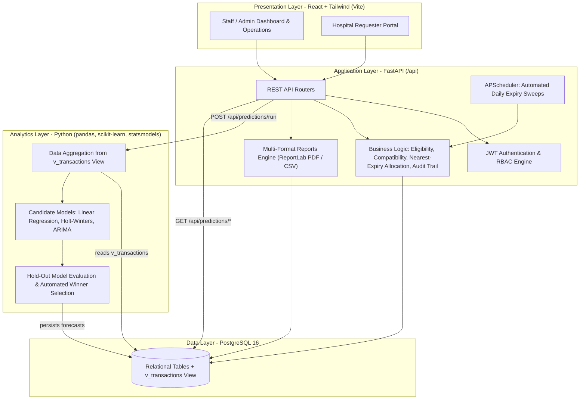

# BloodLink — Blood Bank Management & Availability Prediction System

> **Healthcare Informatics · AI/ML Full-Stack Platform**  
> **Team:** Sakshi (Phases 1–2) · Saee (Phases 3–4) · Esha (Phases 5–6)  
> **Status:** Production Ready (Phases 1–6 Complete)

---

## 1. Executive Summary

**BloodLink** is a modern, enterprise-grade healthcare management platform designed to digitize blood bank operations and transform inventory management from reactive to proactive. In traditional blood banks, stock shortages are only discovered when critical hospital orders go unfulfilled, and blood units frequently expire unused due to manual record-keeping.

BloodLink solves these challenges by combining:
1. **Core Clinical Workflow Engine:** Donor registration with deterministic clinical eligibility verification, automated 42-day whole-blood expiry tracking, emergency-first request prioritization, and atomic, row-locked compatibility matching (`SELECT ... FOR UPDATE`).
2. **Explainable Predictive Analytics:** A time-series forecasting engine (comparing Linear Regression with Seasonality, Holt-Winters Exponential Smoothing, and ARIMA via held-out evaluation) that predicts blood group shortages up to 30 days in advance against configurable safe-minimum stock levels.
3. **Executive Intelligence & Reporting:** An operational dashboard with zero-filled trend analytics, wastage breakdowns, and multi-format report exports (CSV and publication-grade ReportLab landscape PDFs with pagination).
4. **Enterprise Governance:** Strict Role-Based Access Control (Admin, Staff, Requester), immutable activity logging across all state transitions, and referential integrity protection.

---

## 2. System Architecture



---

## 3. Technology Stack

| Layer | Technologies & Libraries |
|---|---|
| **Backend API** | FastAPI (Python 3.11+ / 3.12), Uvicorn, Pydantic v2, pydantic-settings |
| **Database & ORM** | PostgreSQL 16, SQLAlchemy 2.x, Alembic, psycopg v3 (`psycopg[binary]`) |
| **Security & Auth** | PyJWT (HS256 Bearer tokens), Direct `bcrypt` password hashing |
| **Predictive Analytics** | scikit-learn, statsmodels, pandas, numpy |
| **Reporting Engine** | ReportLab (landscape PDF document canvas, running headers, pagination), Python `csv` |
| **Scheduler** | APScheduler (`BackgroundScheduler` for automated 24-hour expiry sweeps) |
| **Frontend UI** | React 18 (Vite, plain JavaScript, strictly no TypeScript), Tailwind CSS, React Router v6, Axios, Recharts, Lucide Icons |
| **Automated Testing** | pytest, pytest-asyncio, httpx (FastAPI TestClient), ESLint |

---

## 4. Key Business Rules & Clinical Logic

1. **Deterministic Donor Eligibility:**
   - Evaluated dynamically via `app.services.eligibility`:
     - **Age:** 18 ≤ age ≤ 65 years (inclusive).
     - **Weight:** ≥ 50.0 kg.
     - **Donation Gap:** ≥ 90 days cooldown between donations.
     - **Regular Donor:** Automatically awarded upon reaching ≥ 3 lifetime donations.
2. **Whole-Blood Expiry & Shelf Life:**
   - Every collected unit has an exact shelf life: `expiry_date = collection_date + 42 days`.
   - Units are **available** while `expiry_date >= today()`. Overdue units are swept to status `expired` (wastage).
3. **Compatibility Matching Matrix:**
   - Canonical clinical matrix implemented in `app.services.compatibility`:
     - Recipient `O-` $\rightarrow$ Safe Donor `O-`
     - Recipient `O+` $\rightarrow$ Safe Donors `O+, O-`
     - Recipient `A-` $\rightarrow$ Safe Donors `A-, O-`
     - Recipient `A+` $\rightarrow$ Safe Donors `A+, A-, O+, O-`
     - Recipient `B-` $\rightarrow$ Safe Donors `B-, O-`
     - Recipient `B+` $\rightarrow$ Safe Donors `B+, B-, O+, O-`
     - Recipient `AB-` $\rightarrow$ Safe Donors `AB-, A-, B-, O-`
     - Recipient `AB+` $\rightarrow$ Safe Donors `AB+, AB-, A+, A-, B+, B-, O+, O-`
4. **All-or-Nothing Atomic Issuing:**
   - Blood unit allocation executes inside a database transaction with `SELECT ... FOR UPDATE` row locks.
   - Units are selected strictly by **nearest expiry first** (`expiry_date ASC, unit_id ASC`).
   - If stock is insufficient, the transaction aborts with HTTP 409 `INSUFFICIENT_STOCK` without partial changes.
   - Traceability is non-negotiable: Every unit links to donor, request, and the issuing staff member.
5. **Time-Series Shortage Forecasting:**
   - Trains on historical daily transactions aggregated from the `v_transactions` SQL view.
   - Compares Linear Regression, Holt-Winters (7-day seasonality), and ARIMA on a chronological 30-day holdout set.
   - Selects the model with the lowest RMSE for each blood group and generates 7–30 day forward projections.
   - Flags shortage alerts whenever projected stock breaches the configurable safe minimum (default 10 units).
6. **Immutable Audit Trail:**
   - Every state change (`create`, `update`, `delete`, `approve`, `reject`, `issue`, `prediction_run`) logs an audit entry to `activity_logs` in the same transaction.

---

## 5. Demo Credentials & User Roles

| Role | Username | Password | Permissions Scope |
|---|---|---|---|
| **Administrator** | `admin` | `admin12345` | Superuser: Staff account provisioning, immutable activity logs, record deletion, executive dashboard, camps, reports, predictions. |
| **Staff Member** | `staff` | `staff12345` | Clinical Operations: Donor registration, recording donations, inventory management, request approval/issuing, camps, reports, predictions. |
| **Hospital Requester** | `hospital` | `hospital12345` | Clinical Orders: Submit routine/emergency blood requests, view status of own hospital requests, edit facility profile. |

---

## 6. Quickstart Setup & Local Execution

### Prerequisites
- Python 3.11 or 3.12
- Node.js 18+ and npm
- Docker Desktop (for PostgreSQL 16) or a local PostgreSQL 16 server

### 1. Database (PostgreSQL 16)
```bash
# Start PostgreSQL via Docker Compose:
docker compose up -d
```
*This starts PostgreSQL on port 5432 and initializes both `bloodlink` and `bloodlink_test` databases.*

### 2. Backend Setup
```bash
cd backend

# Create and activate virtual environment:
python -m venv .venv

# Windows PowerShell:
.\.venv\Scripts\Activate.ps1
# Linux/macOS:
source .venv/bin/activate

# Upgrade pip and install dependencies:
python -m pip install --upgrade pip
pip install -r requirements.txt -r requirements-dev.txt

# Initialize environment configuration:
cp .env.example .env

# Apply database migrations:
alembic upgrade head

# Bootstrap default administrative user:
python -m scripts.create_admin --username admin --password admin12345 --name "System Administrator"

# (Optional) Seed realistic 365-day calibrated demo data:
python -m scripts.seed_synthetic_data --days 365 --seed 42 --reset --yes

# Start FastAPI development server:
uvicorn app.main:app --reload --port 8000
```
- API Documentation (Swagger / OpenAPI): `http://localhost:8000/docs`
- Redoc Documentation: `http://localhost:8000/redoc`

### 3. Frontend Setup
```bash
cd frontend

# Install Node dependencies:
npm install

# Initialize environment configuration:
cp .env.example .env

# Start Vite development server:
npm run dev
```
- Application Portal: `http://localhost:5173`

---

## 7. Running the Automated Test Suite

### Backend Test Suites
```bash
cd backend
# Run all unit, API, ML, security, and integration tests:
pytest -v

# Run exhaustive RBAC audit test:
pytest tests/security/test_rbac_audit.py -v

# Run activity log audit test:
pytest tests/security/test_activity_log_audit.py -v

# Run master full-system integration test:
pytest tests/integration/test_full_system_flow.py -v

# Run ML time-series model tests:
pytest tests/ml/ -v
```

### Frontend Quality Gates
```bash
cd frontend

# Run ESLint (enforces 0 warnings, 0 errors):
npm run lint

# Build production bundle:
npm run build
```

---

## 8. API Specification Summary

| Method | Path | Role Access | Description |
|---|---|:---:|---|
| `GET` | `/api/health` | Public | System health check and uptime status. |
| `POST` | `/api/auth/login` | Public | Authenticate user; returns JWT token. |
| `POST` | `/api/auth/register` | Public | Self-registration for hospital requesters. |
| `GET` | `/api/auth/me` | All Roles | Current authenticated user profile. |
| `GET/POST` | `/api/donors` | Admin, Staff | List donors with filters / Register donor. |
| `GET/PATCH/DEL` | `/api/donors/{id}` | Admin, Staff (DEL: Admin) | Donor profile / Update / Delete donor. |
| `GET` | `/api/donors/{id}/eligibility` | Admin, Staff | Verify donor clinical eligibility. |
| `POST` | `/api/donors/{id}/donations` | Admin, Staff | Record donation and issue blood unit. |
| `GET` | `/api/inventory/stock` | Admin, Staff | Aggregated stock counts by blood group. |
| `GET` | `/api/inventory/units` | Admin, Staff | Paginated blood units with status filters. |
| `POST` | `/api/inventory/expire-overdue` | Admin, Staff | Trigger manual expiry sweep. |
| `GET` | `/api/matching/units` | Admin, Staff | Compatible available units ordered by expiry. |
| `POST` | `/api/requests` | Requester Only | Submit emergency or routine blood request. |
| `GET` | `/api/requests` | All (Filtered) | List requests (requesters see own only). |
| `GET` | `/api/requests/{id}/matches` | Admin, Staff | Compatibility matching & allocation preview. |
| `POST` | `/api/requests/{id}/approve` | Admin, Staff | Approve blood request (`pending -> approved`). |
| `POST` | `/api/requests/{id}/reject` | Admin, Staff | Reject blood request (`pending -> rejected`). |
| `POST` | `/api/requests/{id}/issue` | Admin, Staff | Atomic row-locked unit allocation & issuing. |
| `GET/POST` | `/api/camps` | Admin, Staff | List and schedule donation camps. |
| `GET` | `/api/dashboard/summary` | Admin, Staff | Real-time KPI counts and alert indicators. |
| `GET` | `/api/dashboard/trends` | Admin, Staff | Daily, weekly, monthly donation vs issue trends. |
| `GET` | `/api/dashboard/wastage` | Admin, Staff | Wastage breakdown by group and month. |
| `POST` | `/api/predictions/run` | Admin, Staff | Execute ML prediction pipeline. |
| `GET` | `/api/predictions/latest` | Admin, Staff | Retrieve latest forecasted trajectories. |
| `GET` | `/api/predictions/alerts` | Admin, Staff | Active blood shortage alerts. |
| `GET` | `/api/reports/{type}` | Admin, Staff | Export CSV or ReportLab landscape PDF. |
| `GET/POST` | `/api/staff` | Admin Only | Provision and manage staff user accounts. |
| `GET` | `/api/activity-logs` | Admin Only | Paginated immutable audit trail. |

---

## 9. Directory Structure

```text
BloodLink/
├── backend/
│   ├── alembic/                 # Database migrations (initial schema & v_transactions)
│   ├── app/
│   │   ├── api/                 # REST routers (auth, donors, inventory, requests, etc.)
│   │   ├── core/                # Config, security, JWT, clock, central error handler
│   │   ├── db/                  # SQLAlchemy base and session factory
│   │   ├── jobs/                # APScheduler daily expiry sweep
│   │   ├── models/              # SQLAlchemy ORM models (10 tables)
│   │   ├── schemas/             # Pydantic request/response validation schemas
│   │   └── services/            # Eligibility, matching, issuing, dashboard, reports
│   ├── ml/                      # Machine learning engine (isolated, no app imports)
│   │   ├── models/              # Linear Regression, Holt-Winters, ARIMA wrappers
│   │   ├── data.py              # Time-series aggregation from v_transactions
│   │   ├── evaluation.py        # Hold-out validation and lowest-RMSE selection
│   │   └── pipeline.py          # Forecast runner and persistence
│   ├── scripts/                 # CLI bootstrap and synthetic data generator
│   └── tests/                   # Automated pytest suites (unit, API, ml, security, integration)
├── docs/                        # Quality assurance checklist, demo script, ML evaluation
├── frontend/
│   ├── src/
│   │   ├── api/                 # Axios service layer for all backend modules
│   │   ├── components/          # Shared UI kit (Modal, Table, Button, etc.) and Recharts
│   │   ├── context/             # AuthContext (JWT) and ToastContext
│   │   ├── layouts/             # StaffLayout (sidebar) and RequesterLayout
│   │   ├── pages/               # Functional views for all 7 modules
│   │   └── routes/              # AppRoutes and ProtectedRoute with role guards
│   └── package.json
├── docker-compose.yml           # PostgreSQL 16 container definition
├── IMPLEMENTATION_PLAN.md       # Living project tracker and phase handoffs
└── PROJECT.md                   # Definitive engineering requirements and contracts
```

---

## 10. License & Academic Attribution
Developed as part of the **BloodLink Mini Project** in Healthcare Informatics, DBMS, and AI/ML Software Engineering.
