# BloodLink — Live Demonstration Script & Presentation Narrative

> **Presentation Guide:** End-to-End System Walkthrough  
> **Target Audience:** Evaluators, Healthcare System Administrators, Clinical Staff  
> **Estimated Duration:** 10–12 Minutes  
> **Prerequisites:** Seeded synthetic data via `python scripts/seed_synthetic_data.py --days 365 --seed 42 --reset` (or local PostgreSQL container).  

---

## 1. Demo Credentials Reference Card

| Persona | Username | Password | Role Description | Landing Page |
|---|---|---|---|---|
| **Administrator** | `admin` | `admin12345` | Superuser: staff accounts, full audit logs, deletion authority | `/dashboard` |
| **Blood Bank Staff** | `staff` | `staff12345` | Operational user: donors, donations, stock, queue, issuing, ML | `/dashboard` |
| **Hospital Requester** | `hospital` | `hospital12345` | External clinical requester: emergency & routine blood orders | `/my/requests` |

---

## 2. Demonstration Narrative & Scene-by-Scene Click Path

```mermaid
flowchart LR
    S1["1. Login & Executive Dashboard"] --> S2["2. Donor Intake & Eligibility Check"]
    S2 --> S3["3. Recording Donation & Expiry Engine"]
    S3 --> S4["4. Hospital Portal & Emergency Order"]
    S4 --> S5["5. Staff Queue, Matching & Atomic Issue"]
    S5 --> S6["6. Wastage Analysis & Inventory Refresh"]
    S6 --> S7["7. Shortage Prediction & ML Evaluation"]
    S7 --> S8["8. Multi-Format PDF/CSV Reports"]
    S8 --> S9["9. Admin Staff & Immutable Audit Trail"]
```

---

### Scene 1: Introduction & Executive Dashboard (2 minutes)
- **Actor:** Log in as `staff` (`staff / staff12345`).
- **Narrative:**
  > *"Welcome to BloodLink. Traditional blood bank systems operate as passive spreadsheets or paper registers. BloodLink is an intelligent, proactive platform that not only manages the complete operational lifecycle of a blood bank, but predicts upcoming blood group shortages before they occur."*
- **Click-Path:**
  1. Navigate to **Dashboard** (`/dashboard`).
  2. Point out the headline KPI cards:
     - **Total Available Units:** real-time count of usable, unexpired units.
     - **Expiring Soon (7 Days):** early-warning buffer to prevent wastage.
     - **Pending Requests:** separated into Emergency vs Routine.
     - **Predicted Shortages:** alert banner driven by our machine learning pipeline.
  3. Highlight the **Stock by Blood Group** bar chart:
     - Explain the dashed red reference line: **Safe Minimum Threshold (10 units)**.
     - Point out low-stock groups highlighted in amber/red.
  4. Demonstrate the **Donations vs. Issues Trends** chart:
     - Toggle between **Daily**, **Weekly (Monday-aligned)**, and **Monthly** granularity.
     - Filter by a specific blood group (e.g. `O+` or `B+`) to demonstrate zero-filled trend consistency.

---

### Scene 2: Donor Intake & Pure Eligibility Engine (1.5 minutes)
- **Actor:** Still logged in as `staff`.
- **Narrative:**
  > *"Every donation begins with strict safety checks. BloodLink features a deterministic, pure eligibility engine that enforces national medical guidelines: age 18 to 65, minimum weight 50 kilograms, and a mandatory 90-day cooldown between whole-blood donations."*
- **Click-Path:**
  1. Click **Donors** in the sidebar (`/donors`).
  2. Click **+ Register Donor** (`/donors/new`).
  3. Fill out the form with a valid donor:
     - Name: `Vikram Malhotra`
     - DOB: `1992-08-14`
     - Gender: `Male`
     - Blood Group: `O-` *(Universal donor)*
     - Weight: `72 kg`
     - Phone: `9820199887`
     - Address: `Colaba, Mumbai`
  4. Submit the form. The system redirects to the new donor's profile page (`/donors/{id}`).
  5. Point out the **Live Eligibility Card**:
     - Green badge: **Eligible to Donate**.
     - Next eligible date: **Immediate**.
     - Regular donor indicator: Currently `0 donations` (becomes a "Regular Donor" at ≥ 3 donations).

---

### Scene 3: Recording Donation & Expiry Tracking (1.5 minutes)
- **Actor:** Still on Donor Profile page.
- **Narrative:**
  > *"When the donation is drawn, the system atomically updates the donor's record and generates a tracked blood unit with a strict 42-day whole-blood shelf life."*
- **Click-Path:**
  1. Click **Record Donation**.
  2. Confirm the action in the prompt.
  3. Notice the immediate success toast showing the new **Unit ID** and **Expiry Date** (`collection_date + 42 days`).
  4. The Eligibility Card immediately flips to **Not Eligible**:
     - Reason: `DONATION_GAP_NOT_MET` (90-day cooldown active).
     - Next eligible date updated to exactly 90 days from today.
  5. Navigate to **Inventory** (`/inventory`):
     - Filter by `O-`.
     - Locate the newly drawn unit with status `available`.
     - Switch to the **Expiring Soon** tab to show proactive shelf-life monitoring.

---

### Scene 4: Hospital Portal & Emergency Blood Request (1.5 minutes)
- **Actor:** Log out of staff and log in as `hospital` (`hospital / hospital12345`).
- **Narrative:**
  > *"BloodLink provides a dedicated portal for hospitals and emergency clinics to place verified blood requests without administrative delays."*
- **Click-Path:**
  1. The hospital user lands directly on **My Requests** (`/my/requests`).
  2. Point out that the hospital only sees their own requests — strict data isolation is enforced.
  3. Click **+ New Blood Request** (`/my/requests/new`).
  4. Fill out the request:
     - Blood Group: `B+`
     - Quantity: `2` units
     - Urgency: Select **Emergency** (red pulse indicator).
     - Patient Name: `Kavita Sen (ICU Bed 4)`
     - Clinical Notes: `Immediate surgical intervention required`.
  5. Click **Submit Request**.
  6. The request appears in the list with a high-priority red **Emergency** badge and status `Pending`.

---

### Scene 5: Staff Request Queue, Compatibility Matching & Atomic Issuing (2 minutes)
- **Actor:** Log out and log back in as `staff`.
- **Narrative:**
  > *"In an emergency, staff need instant answers: Are there compatible units in stock, and which unit should be issued first? BloodLink implements an automated compatibility matrix and nearest-expiry-first allocation algorithm with atomic row locking."*
- **Click-Path:**
  1. Navigate to **Requests Queue** (`/requests`).
  2. Point out that the Emergency request from `Apollo Hospital / City Clinic` has automatically jumped to the **very top of the queue**, ahead of routine requests.
  3. Click on the request row to open the **Request Detail Page** (`/requests/{id}`).
  4. Inspect the **Compatibility & Matches Panel**:
     - Requested Blood Group: `B+`.
     - Compatible Donor Groups: `B+, B-, O+, O-` (as per clinical whole-blood compatibility).
     - Available Compatible Units: Shows total compatible count.
     - **Allocation Preview:** Pre-selects the candidate units ranked strictly by **nearest expiry first** (`expiry_date ASC, unit_id ASC`).
  5. Click **Approve Request**; confirm status transition `pending → approved`.
  6. Click **Issue Units**:
     - System executes a database transaction with `SELECT ... FOR UPDATE` row locks.
     - The units are marked `issued`, `issue_records` are generated connecting donor, unit, request, and staff member, and the request status transitions to `issued`.
  7. Point out the **Issued Units Table** on the page detailing unit serials and donor blood groups.
  8. Return to **Inventory** (`/inventory`): The issued units have been decremented from available stock immediately.

---

### Scene 6: Wastage Analysis & Donation Camps (1 minute)
- **Actor:** Still logged in as `staff`.
- **Narrative:**
  > *"Managing shortages requires continuous community outreach. BloodLink tracks donation camps and monitors wastage rates."*
- **Click-Path:**
  1. Navigate to **Donation Camps** (`/camps`).
  2. Point out upcoming community donation drives with target vs. collected progress bars.
  3. Click **+ Schedule Camp**: Add a new drive (e.g. `IIT Bombay Campus Drive`, Date, Target: 100 units).
  4. Return to **Dashboard** (`/dashboard`) and scroll to the **Wastage Analysis** section:
     - Show the blood-group breakdown of expired units.
     - Explain how proactive alerts reduce whole-blood wastage to near zero.

---

### Scene 7: Shortage Prediction & Machine Learning Engine (2 minutes)
- **Actor:** Still logged in as `staff`.
- **Narrative:**
  > *"Here is the crown jewel of BloodLink: Explainable predictive analytics. Rather than waiting for a stockout, our machine learning models forecast demand and supply up to 30 days into the future."*
- **Click-Path:**
  1. Click **Predictions & ML** (`/predictions`).
  2. Point out the **Active Shortage Alerts** banner:
     - Shows any blood group projected to breach the safe minimum within the forecast horizon.
     - Details: Current Stock, Safe Minimum, First Projected Shortage Date, and Days Until Shortage.
  3. Review the **Interactive Forecast Chart**:
     - Click through blood group tabs (`A+`, `B+`, `O+`, `O-`, etc.).
     - Observe the predicted stock trajectory plotted against the dashed red **Safe Minimum** reference line.
  4. Scroll down to the **Model Evaluation & Selection Table**:
     - Explain the three candidate models: **Linear Regression with Seasonality**, **Holt-Winters Exponential Smoothing**, and **ARIMA**.
     - BloodLink splits historical data with a chronological 30-day holdout, computes **MAE** and **RMSE** for each candidate, and **automatically selects the best-performing model** for each blood group.
     - Point out the green badge indicating the winning model selected for production forecasting.
  5. Select a **14-day** horizon and click **Run Prediction Pipeline**:
     - Live spinner indicates real-time model retraining and persistence to the `shortage_predictions` table.

---

### Scene 8: Multi-Format Reports Export (1 minute)
- **Actor:** Still logged in as `staff`.
- **Narrative:**
  > *"For regulatory compliance and hospital auditing, BloodLink generates publication-grade reports in standard CSV and landscape ReportLab PDF."*
- **Click-Path:**
  1. Click **Export Reports** (`/reports`).
  2. Point out the 7 report domains:
     - `Inventory Summary`, `Donations Log`, `Issue & Dispatch Log`, `Wastage & Expiry Audit`, `Registered Donors`, `Blood Request Log`, `Shortage Forecast Audit`.
  3. Select **Donations Log**.
  4. Select **Format: PDF (ReportLab)**.
  5. Click **Download Report**:
     - Browser downloads `bloodlink_donations_YYYYMMDD.pdf`.
     - Open the PDF: Showcase the professional landscape layout, blood bank header, repeated table column headers, and `"Page X of Y"` footer pagination.
  6. Switch format to **CSV** and download to show spreadsheet compatibility.

---

### Scene 9: Administrator Portal & Immutable Audit Trail (1 minute)
- **Actor:** Log out and log in as `admin` (`admin / admin12345`).
- **Narrative:**
  > *"Finally, enterprise security and governance. Administrators have exclusive oversight over staff access and an immutable audit trail."*
- **Click-Path:**
  1. Notice the additional **Administration** section in the sidebar.
  2. Navigate to **Staff Accounts** (`/admin/staff`):
     - View staff members and roles.
     - Show the **Self-Modification Guard**: The logged-in admin cannot delete or demote themselves.
  3. Navigate to **Activity Logs** (`/admin/activity-log`):
     - Every state mutation performed during the demo is logged with user ID, action (`create`, `approve`, `issue`), entity type, IP address, and timestamp.
     - Click **View Details** on any log row to open the structured JSON viewer modal.
  4. Conclude the demonstration:
     > *"BloodLink transforms blood banking from a reactive emergency scramble into an organized, proactive, data-driven healthcare service."*
